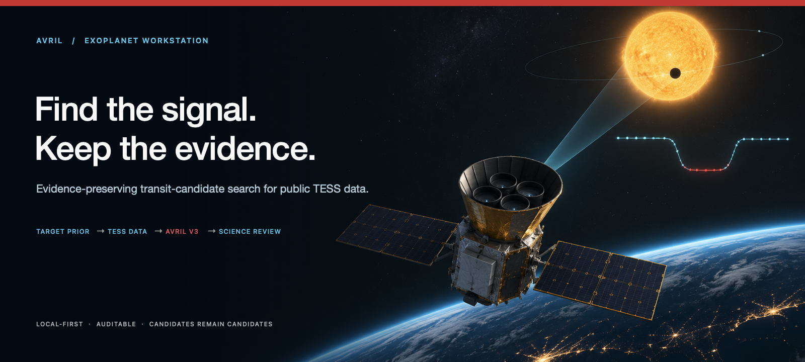
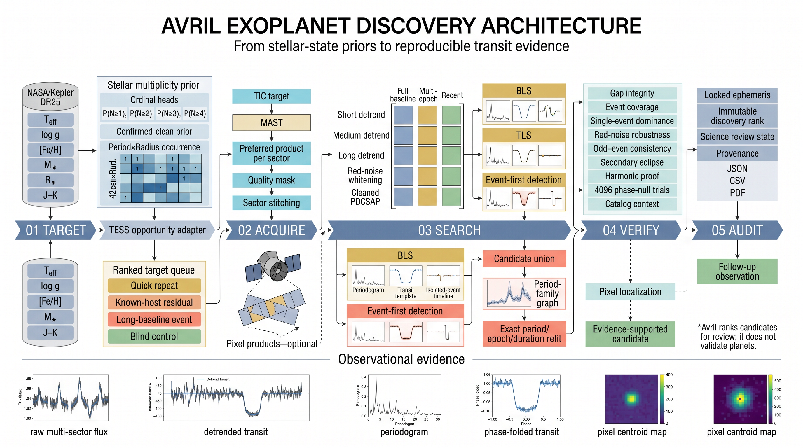
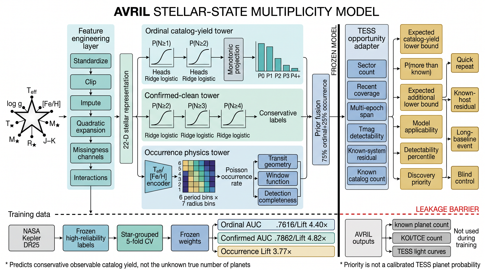
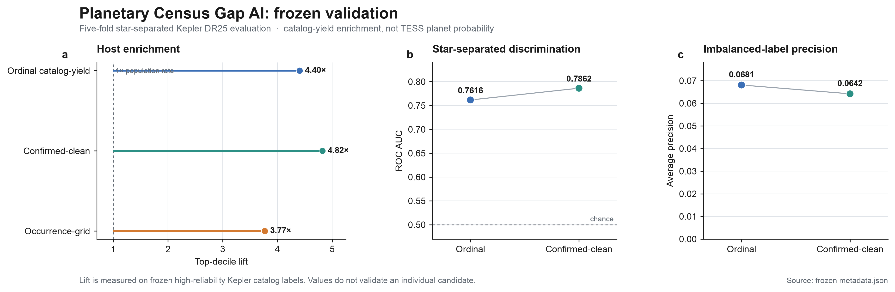
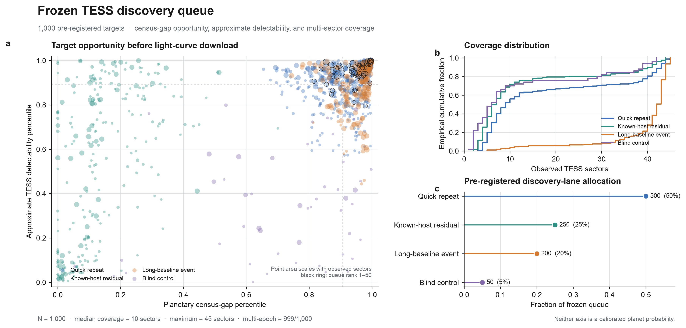
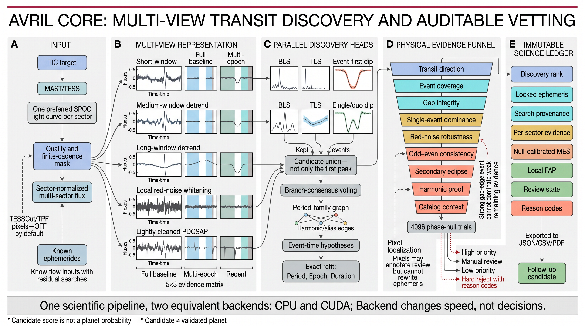

# Avril Exoplanet Workstation

**AI-Guided Exoplanet Candidate Discovery System**

*Exoplanet discovery for everyone.*

[](docs/SCIENTIFIC_CONTRACT.md)
[](Package.swift)
[](Package.swift)
[](Engine/pyproject.toml)
[](LICENSE)

[English](README.md) · [简体中文](README_zh.md)

[Research overview](docs/RESEARCH_OVERVIEW.md) ·
[Architecture](docs/ARCHITECTURE.md) ·
[Planetary Census Gap AI](docs/TARGET_PRIOR.md) ·
[Validation](docs/VALIDATION.md) ·
[Scientific contract](docs/SCIENTIFIC_CONTRACT.md) ·
[Quick start](#quick-start-on-macos)



We hope that no soul looking up at the stars will be forgotten by time.

Avril is a locally running, AI-guided planet-search system. It identifies the
targets most worthy of deeper inspection from large-scale public stellar data,
automatically analyzes TESS observations, finds overlooked planetary signals,
and reviews every transit candidate through a complete and reproducible chain
of evidence.

The system consists of two connected core components:

### 1. Planetary Census Gap AI

Planetary Census Gap AI uses stellar temperature, radius, mass, surface
gravity, metallicity, color, and other physical properties to estimate a
conservative distribution of observable planet counts.

The model then compares this expected distribution with the number of planets
already recorded in catalogs, identifying stellar systems whose current
planetary census may be incomplete.

If a star is physically similar to known multi-planet systems but currently has
only one—or no—recorded planet, it may exhibit a larger Planetary Census Gap
and receive higher search priority.

It helps Avril decide which stars should receive limited computing resources
first.

### 2. Automated Transit Search Engine

For these prioritized targets, Avril jointly analyzes light curves across
multiple sectors, observing years, and timescales.

The search includes multi-scale detrending, BLS, optional TLS, individual-event
search, exact period refitting, cross-sector evidence comparison, gap-boundary
diagnostics, red-noise tests, harmonic analysis, physical vetting, and optional
pixel-level source localization.

The system searches for transit signals that may have been missed by existing
catalogs and automated pipelines, while retaining every candidate's period,
events, diagnostics, rejection reasons, and complete run record.

Together, the two components focus the limited computing resources of a
personal Mac/iPhone on the stars most worth re-examining, while preserving all
evidence required for independent scientific review.

Avril aims to make rigorous exoplanet-candidate discovery no longer the sole
domain of a small number of large teams and specialized pipelines.

With public observations, transparent AI models, and reproducible search tools,
students, researchers, educators, astronomy enthusiasts, and everyone curious
about unknown worlds can begin a genuine scientific search on their own
computer—and may discover a planetary candidate that has not been noticed
before.

> **Among billions of stars, one world may be waiting for you to find it.** 亿万星辰之中，也许有一个世界，正等待被你发现。

## Technical overview

Transit searches usually optimize a single detection statistic. Avril instead optimizes the integrity of the full evidence trail:

- every base peak and locked ephemeris remains in the audit ledger;
- catalog truth is attached only after blind search and ranking;
- harmonic relationships require supported event-time evidence;
- candidates dominated by gaps or incomplete windows are explicitly downgraded;
- two- and three-event signals remain available for manual review;
- CPU and CUDA backends use the same grids, gates, and thresholds;
- pixel localization is optional follow-up and is off by default;
- FITS data, run records, and exported reports remain on the local machine.

## System overview



*Figure 1. End-to-end Avril discovery architecture, from the frozen
stellar-state prior and public TESS acquisition to multi-view search,
evidence-based vetting, and an immutable science ledger.*

The public workflow has four layers:

1. **Target intelligence** ranks finite compute using frozen stellar-state priors and transparent TESS opportunity features.
2. **Data acquisition** selects one preferred official SPOC/TESS-SPOC light curve per sector or performs label-free raw-FFI self-photometry.
3. **Avril Core** runs complete-grid discovery, deterministic cross-sector voting, exact refits, event/gap checks, physical diagnostics, and exact phase-null trials.
4. **Science review** preserves immutable discovery rank, publishes a separate science rank, and exports the complete candidate ledger and receipts.

Read the [architecture and scientific contract](docs/ARCHITECTURE.md) before changing the search path.

## Planetary Census Gap AI



*Figure 2. Leakage-controlled Planetary Census Gap AI. Frozen stellar-state
models estimate conservative catalog yield; transparent TESS opportunity
features route targets without entering the transit statistic.*

The bundled queue contains 1,000 TESS targets. Its stellar prior was trained on a frozen, high-reliability Kepler DR25 catalog using only effective temperature, surface gravity, metallicity, stellar mass, stellar radius, and J−K color. KOI/TCE counts, known planet counts, brightness, noise, observing duration, and all TESS light-curve evidence were excluded from the stellar prior.

Five-fold validation is split at the **star** level, so every planet around one
star remains in the same fold.

### Main Planetary Census Gap AI results

| Frozen model view | ROC AUC | Average precision | Top-decile lift |
|---|---:|---:|---:|
| Ordinal catalog-yield prior | 0.7616 | 0.0681 | **4.40×** |
| Confirmed-clean prior | **0.7862** | 0.0642 | **4.82×** |
| Occurrence-grid reference | — | — | **3.77×** |



*Figure 3. Reproducible plots rendered directly from the frozen public model
metadata. Lift measures catalog-host enrichment and is not a calibrated planet
probability.*

Top-decile lift measures how strongly known high-reliability Kepler hosts are
enriched among the highest-ranked 10%. These are out-of-fold measurements on
frozen Kepler labels—not calibrated TESS planet probabilities and not a transit
detection benchmark.

The full model card, hashes, label definition, domain-shift warning, and discovery-lane design are documented in [Target Prior](docs/TARGET_PRIOR.md).



*Figure 4. The frozen 1,000-target queue before light-curve download. Census
gap, approximate TESS detectability, discovery lane, and observing coverage are
kept as distinct, auditable quantities.*

## Avril Core



*Figure 5. Avril Core preserves parallel detrending and discovery views,
unifies supported candidates without keeping only the first peak, and passes
each locked ephemeris through a physical-evidence funnel. CPU and CUDA change
execution speed, not scientific decisions.*

The discovery score ranks candidates for review; it is not a planet
probability. A promoted candidate remains a candidate until independent
astrophysical validation.

## Validation snapshot

| Layer | Release-candidate check | Result |
|---|---|---:|
| Python public interface | `pytest -q Engine/avril` | 24 passed |
| Scientific-core regression | documented deterministic CPU suite | 93 passed |
| Python static analysis | Ruff over public engine and bridge | Pass |
| Native workstation | Swift release build | Pass, zero warnings |
| Local bridge | Health response and frozen target catalog | Ready, 1,000 targets |
| macOS source-build bundle | Strict deep code-signature verification | Pass |
| Repository audit | Paths, credentials, caches, generated science files | Pass |

These checks verify packaging and declared invariants; they do not establish
population-level completeness or false-positive calibration. Exact commands,
scope, and remaining publication-grade evaluation work are recorded in
[Validation](docs/VALIDATION.md).

## Repository map

| Path | Purpose |
|---|---|
| `Sources/AvrilNova/` | Native SwiftUI/AppKit workstation, scientific plots, 3D mission context, task queue, run records, and PDF export |
| `Engine/` | Avril V3 command-line engine, CPU/CUDA kernels, target queue, tests, and reproducibility documents |
| `Resources/` | Redistributable mission imagery used by the native application |
| `Vendor/` | Pinned native binary dependency used by the application |
| `VendorLicenses/` | Exact licenses for vendored components |
| `docs/` | Scientific contract, model card, architecture, data policy, and release process |
| `scripts/` | Engine bootstrap, native build, development launch, icon generation, and release audit |

The macOS interface is native. It does not embed HTML or a WebView.

## Quick start on macOS

Requirements:

- macOS 15 or newer;
- Xcode command-line tools with Swift 6.1;
- Python 3.11, 3.12, or 3.13;
- internet access only when downloading public TESS products.

```bash
git clone https://github.com/ShutongLiang/Avril.git
cd avril

# Create the local Python science environment.
./scripts/bootstrap_engine.sh scout

# Build the native .app from this checkout.
AVRIL_NOVA_SKIP_RUNTIME=1 ./scripts/build_app.sh

# Launch the app against the local engine environment.
./scripts/run_dev_app.sh
```

The default source build is intentionally not notarized. A public binary release must embed a relocatable Python runtime, pass the release audit, and be signed and notarized; see [Releasing](docs/RELEASING.md).

## Command-line engine

The same scientific engine is available without the desktop application:

```bash
source .venv/bin/activate
avril doctor --backend cpu

# Preferred official light curves; no post-search pixel download.
avril run "TOI-786" --source spoc --pixels none --backend cpu

# Automatic SPOC-first acquisition with optional follow-up localization.
avril run "TIC 375059587" --source auto --pixels followup --backend auto
```

For frozen-input runs:

```bash
avril manifest "TIC 375059587" --output manifests/tic-375059587.json
avril run manifests/tic-375059587.json --backend auto
```

Large data should be placed explicitly with `AVRIL_DATA_DIR`. When it is unset, Avril uses the native application-data location for the current operating system.

## Scientific status

Avril V3 is a **research preview**. Known-system regressions and deterministic unit tests verify important invariants, but they are not population-level completeness or false-positive calibration. Before publishing survey-level claims, use a new TIC-disjoint sealed split, injection/recovery in real TESS noise, and negative controls covering binaries, rotation, red noise, instrument periods, phase shifts, gaps, and inverted light curves.

See:

- [Scientific Contract](docs/SCIENTIFIC_CONTRACT.md)
- [Research Overview](docs/RESEARCH_OVERVIEW.md)
- [Architecture](docs/ARCHITECTURE.md)
- [Target Prior Model Card](docs/TARGET_PRIOR.md)
- [Validation Record](docs/VALIDATION.md)
- [Data and Privacy](docs/DATA_AND_PRIVACY.md)
- [Engine Reproducibility](Engine/docs/REPRODUCIBILITY.md)
- [Failure Modes](Engine/docs/PITFALLS.md)

## Contributing

Scientific-path changes require deterministic tests, a public regression target, and evidence that candidate count and locked ephemerides are preserved. Performance changes must disclose any computation removed. Read [CONTRIBUTING.md](CONTRIBUTING.md) before opening a pull request.

Security issues involving untrusted FITS/JSON parsing or the loopback bridge should follow [SECURITY.md](SECURITY.md).

## Citation and license

Avril is licensed under [Apache License 2.0](LICENSE). If Avril contributes to research, cite the software release using [CITATION.cff](CITATION.cff) and acknowledge the upstream TESS/MAST data products used in the analysis.

```bibtex
@software{avril2026,
  title   = {Avril: Evidence-Preserving Transit-Candidate Search},
  author  = {{Avril contributors}},
  year    = {2026},
  version = {3.0.0},
  url     = {https://github.com/ShutongLiang/Avril}
}
```

Third-party code and image provenance are recorded in [THIRD_PARTY_NOTICES.md](THIRD_PARTY_NOTICES.md). NASA, Adobe, Apple, JHU, NJU, and other institutions do not endorse this software unless a separate written statement says otherwise.
