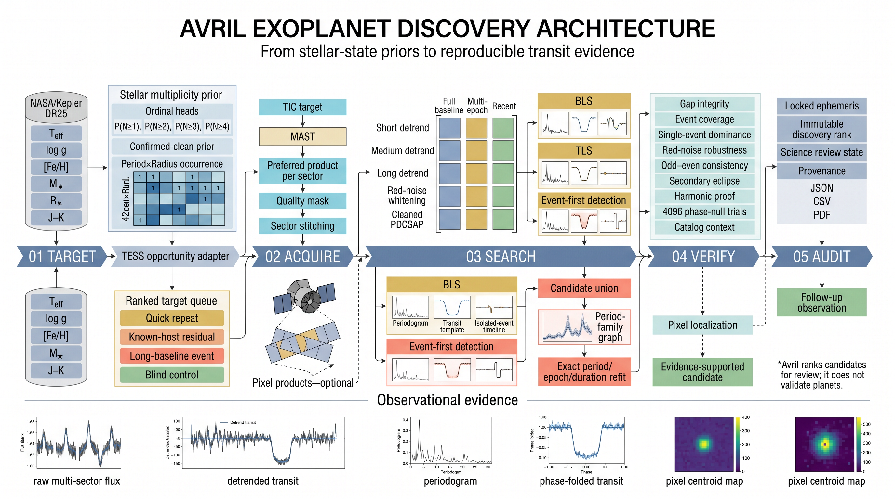
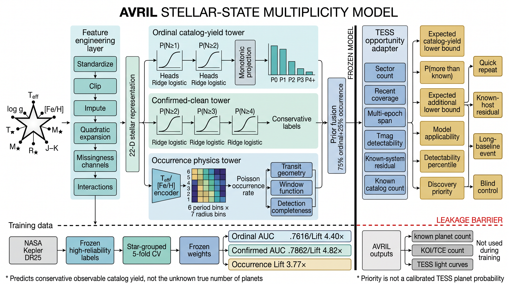
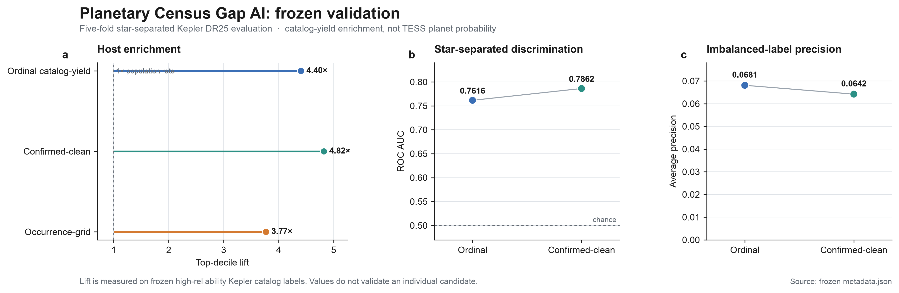
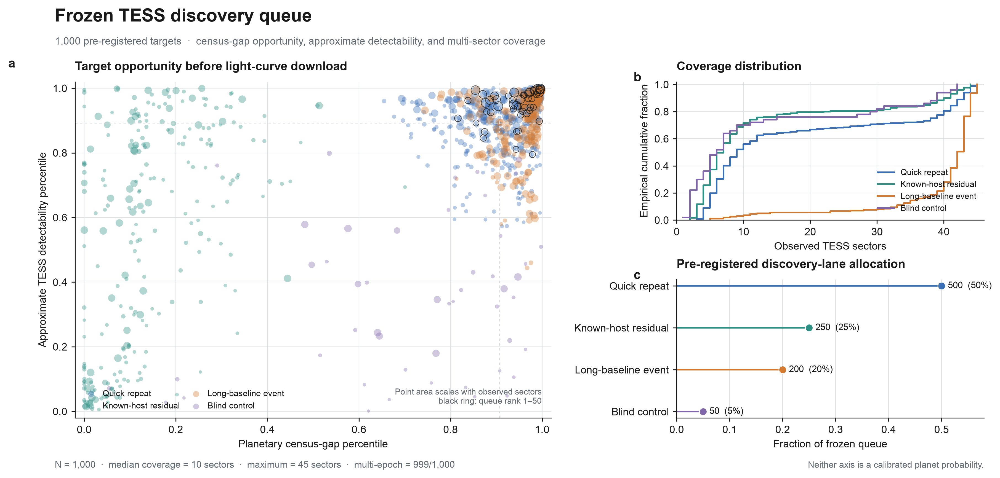
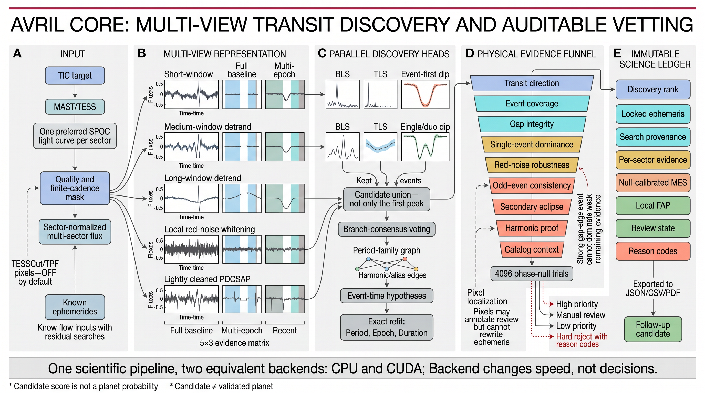

# Avril

## 面向所有人的新行星发现系统

我们希望，每个仰望星空的灵魂，都不被时间遗忘。

Avril 是一套在本地运行、由人工智能引导的行星搜索系统。它从大规模公开恒星数据中识别最值得深入检查的目标，自动分析 TESS 观测，找到被遗漏的行星信号，并通过完整、可复现的证据链复核每一个凌星候选。

系统由两个相互衔接的核心组件构成：

### 1. Planetary Census Gap AI

Planetary Census Gap AI 根据恒星的温度、半径、质量、表面重力、金属丰度和颜色等物理状态，估计其保守的“可观测行星数量分布”。

模型随后将这一期望分布与目录中已经记录的行星数量进行比较，识别现有行星普查结果可能尚不完整的恒星系统。

如果一颗恒星在物理状态上与已知多行星系统相似，但目前只记录了一颗、甚至没有记录行星，它就可能形成较大的 Planetary Census Gap，并获得更高的搜索优先级。

它帮助 Avril 判断，有限的计算资源应该首先投入到哪些恒星。

### 2. 自动化凌星搜索引擎

针对这些优先目标，Avril 联合分析多个 Sector、多个观测年份和不同时间尺度下的光变数据。

搜索流程包括多尺度去趋势、BLS、可选 TLS、独立事件搜索、精确周期重拟合、跨 Sector 证据比对、缺测边界诊断、红噪声检验、谐波分析、物理排假，以及可选的像素级信号源定位。

系统寻找的是可能被现有目录和自动管线遗漏的凌星信号，同时保留每一个候选的周期、事件、诊断结果、拒绝原因和完整运行记录。

两个组件共同将个人 Mac/iphone 上有限的计算资源集中到更值得重新检查的恒星，并保留独立科学复核所需的全部证据。

Avril 想做的，是让严谨的系外行星候选发现不再只属于少数大型团队和专业管线。

借助公开的观测数据、透明的人工智能模型和可复现的搜索工具，学生、研究人员、教师、天文爱好者，以及每一位对未知世界保持好奇的人，都可以在自己的电脑上开始一次真正的科学搜索，并有机会发现一个此前未被注意到的行星候选。

> Among billions of stars, one world may be waiting for you to find it. 亿万星辰之中，也许有一个世界，正等待被你发现。

---

## 科研架构与冻结验证



*图 1：Avril 从冻结的恒星状态先验、公开 TESS 数据获取，到多视图搜索、物理证据排假与不可变科学记录的完整架构。*



*图 2：受数据泄漏防线约束的 Planetary Census Gap AI。冻结的恒星状态模型估计保守目录产出，TESS 观测机会仅作为透明的目标路由信息。*



*图 3：直接从公开冻结模型元数据生成的可复现验证图。Lift 表示目录中已知高可靠度宿主的富集程度，不是经校准的行星概率。*



*图 4：下载光变数据前的 1,000 目标冻结队列。行星普查缺口、近似 TESS 可探测性、发现通道和观测覆盖均保持为独立且可审计的量。*



*图 5：Avril Core 保留并行的去趋势与发现视图，联合有事件支撑的候选，并将锁定的星历送入物理证据漏斗。CPU 与 CUDA 只改变速度，不改变科学判定。*

上述两张统计图均可由 `scripts/render_research_figures.py` 从仓库中的冻结公开数据重新生成。候选排名不是行星概率；被提升的信号在独立天体物理验证之前仍然只是候选。

---

## 使用说明

### 当前版本

Avril V3 当前以研究预览版发布。仓库包含原生 macOS 科学工作站、CPU/CUDA 搜索引擎、冻结的 1,000 目标优先队列、Planetary Census Gap AI 模型文件、测试与可复现性文档。

当前原生应用要求：

- macOS 15 或更高版本；
- 带 Swift 6.1 的 Xcode Command Line Tools；
- Python 3.11、3.12 或 3.13；
- 下载公开 TESS 产品时需要网络连接。

### 安装和启动

```bash
git clone https://github.com/ShutongLiang/Avril.git
cd avril

# 建立本地科学计算环境，并安装可选 TLS 搜索通道。
./scripts/bootstrap_engine.sh scout

# 构建原生 macOS 应用。
AVRIL_NOVA_SKIP_RUNTIME=1 ./scripts/build_app.sh

# 启动应用并连接本地 Avril 引擎。
./scripts/run_dev_app.sh
```

默认源码构建版本使用本地签名，不是经过 Apple 公证的公开二进制发行版。面向普通用户直接下载的 `.app` 或 `.dmg` 还需要内置可迁移的 Python 运行环境、Developer ID 签名、Apple notarization，以及干净 Mac 环境下的 Gatekeeper 测试。

### 基本工作流程

1. 在工作台中浏览 Planetary Census Gap AI 生成的优先目标目录，或直接输入 TIC/TOI 标识符。
2. 将一个或多个目标加入本地任务队列。
3. 下载并整理可用的 TESS 光变产品；像素复核默认关闭。
4. 运行 Avril V3 的多分支凌星搜索和证据检查流程。
5. 在运行记录中查看候选周期、逐 Sector 证据、相位折叠光变、缺测诊断、红噪声结果和排假状态。
6. 对值得进一步检查的候选按需下载像素数据，并导出 JSON、CSV 或 PDF 报告。

### 命令行使用

```bash
source .venv/bin/activate
avril doctor --backend cpu

# 使用优先官方光变；默认不下载后续像素复核数据。
avril run "TOI-786" --source spoc --pixels none --backend cpu

# 自动选择数据源，并对通过科学复核的候选执行可选像素定位。
avril run "TIC 375059587" --source auto --pixels followup --backend auto
```

### 数据与隐私

计算、FITS 数据、任务记录和导出报告均保存在本机。可以通过 `AVRIL_DATA_DIR` 指定大体积科学数据的位置。若未设置，Avril 使用当前操作系统的原生应用数据目录。

### 结果解释

Avril 输出的是需要进一步复核的凌星候选，而不是已经确认的行星。目标排序用于安排搜索顺序，并不等同于恒星存在行星的概率。单个候选仍然需要目录核查、信号源定位、邻星分析、独立观测和专家复核。

当前测试验证软件接口、确定性科学不变量和已知系统回归，但不代表已经完成总体搜索完备率或假阳性率标定。

### 进一步文档

- [研究概述](docs/RESEARCH_OVERVIEW.md)
- [系统架构](docs/ARCHITECTURE.md)
- [Planetary Census Gap AI 模型说明](docs/TARGET_PRIOR.md)
- [验证记录](docs/VALIDATION.md)
- [科学边界](docs/SCIENTIFIC_CONTRACT.md)
- [数据与隐私](docs/DATA_AND_PRIVACY.md)
- [发布流程](docs/RELEASING.md)

Avril 采用 [Apache License 2.0](LICENSE) 开源。第三方代码、组件和图像的来源与许可证记录在 [THIRD_PARTY_NOTICES.md](THIRD_PARTY_NOTICES.md) 中。
