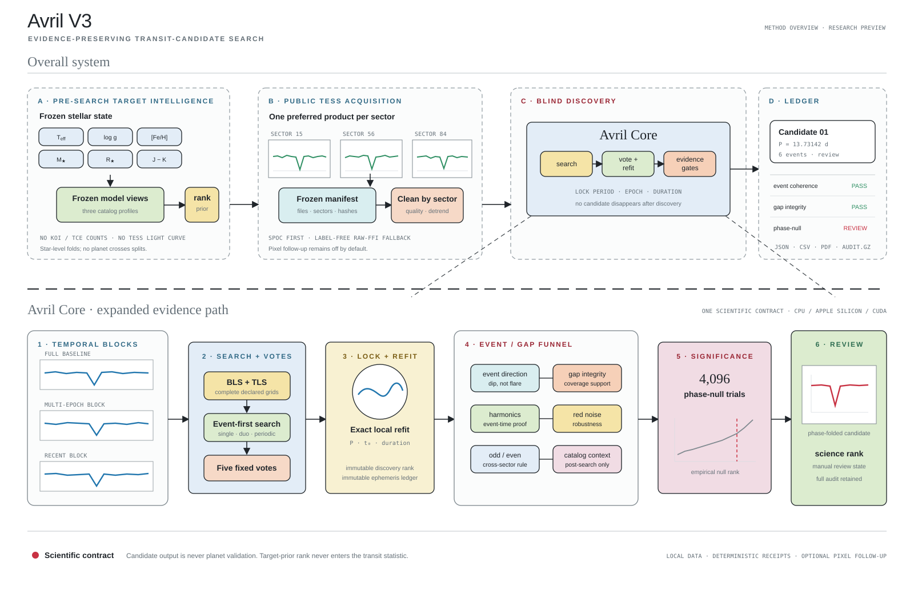

# Architecture and scientific boundaries



## One scientific path

Avril has one public candidate contract and two numerical backends. Backend selection may change throughput, but it must not change:

- the configured period/duration grid;
- deterministic vote seeds;
- exact refit budgets unless the run is explicitly deferred;
- phase-null trial count;
- candidate count or locked period, epoch, and duration;
- automatic priority thresholds;
- audit, skip-reason, and timing receipts.

The engine architecture and source map are maintained in [Engine/docs/ARCHITECTURE.md](../Engine/docs/ARCHITECTURE.md).

## Product layers

### Native workstation

The SwiftUI/AppKit application manages target ranking, public data acquisition, execution, light-curve inspection, optional pixel validation, candidate review, run records, and PDF/JSON export. Core Plot renders scientific light curves; SceneKit renders mission context. The desktop client talks only to an owned loopback process and terminates that process with the application.

### Local engine bridge

`Engine/desktop_bridge.py` exposes a narrow local API for job creation, cancellation, progress, light curves, candidate folds, timelines, results, and audit artifacts. It is not a general shell. The bridge binds to `127.0.0.1`, uses per-job control tokens, restricts artifacts to the configured data root, and is not designed for remote deployment.

### Avril V3 engine

The Python/C++/CUDA engine freezes input manifests, downloads or ingests public photometry, performs label-free preprocessing, searches complete temporal blocks, votes across fixed resamples, locks and refits candidate families, evaluates event coherence and gap integrity, runs physical/reference gates, and selectively executes exact phase-null tests. Every candidate remains in the ledger even when a later stage is skipped.

### Target intelligence

Target ranking is deliberately separated from transit evidence. The frozen model selects which targets should receive finite compute first. It cannot create a transit candidate and is not read by the blind discovery search.

## Data flow

```text
frozen target row / user TIC
          |
          v
public SPOC products ---- or ---- raw TESSCut pixels
          |                         |
          |                  self-photometry
          +------------+------------+
                       v
             frozen source manifest
                       |
            clean + detrend by sector
                       |
       three temporal blocks + five votes
                       |
           exact local period/epoch refit
                       |
 event direction + harmonic + catalog + gap funnel
                       |
  physical/reference gates + 4,096 phase-null trials
                       |
   immutable discovery rank + separate science rank
                       |
       JSON / gzip audit / CSV / native PDF report
```

## Trust boundaries

- Public FITS and JSON inputs are untrusted.
- The GUI never accepts arbitrary shell commands.
- Catalog truth is post-search metadata, not a discovery feature.
- Pixel localization can alter review state but cannot alter locked ephemerides.
- A high-priority row is still a follow-up candidate, not a validated planet.
