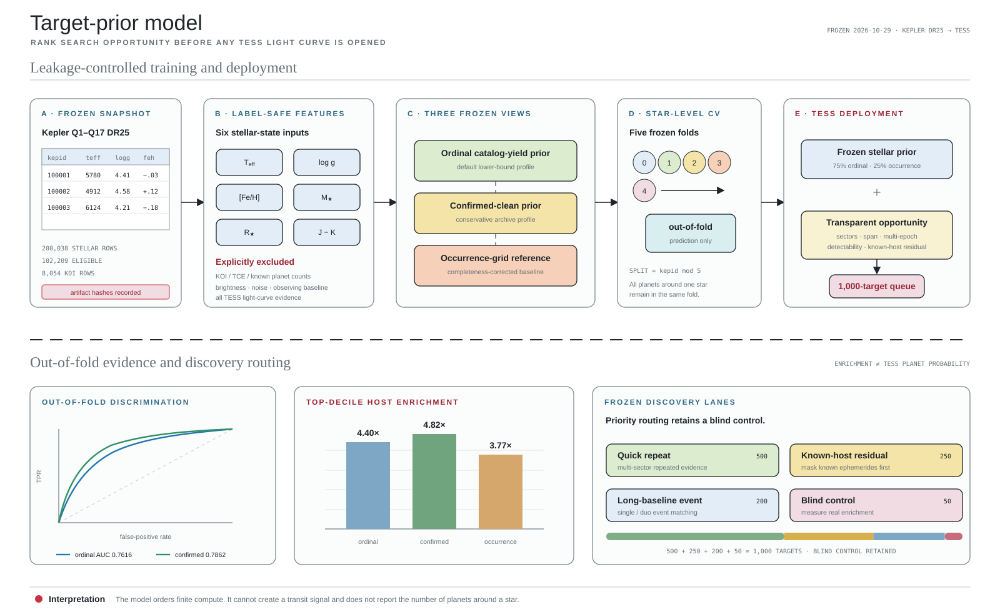

# Planetary Census Gap AI model card

## Intended use

The target-prior system ranks stars for finite-compute transit searches. It answers: **which targets should Avril search first?** It does not answer whether a particular light curve contains a transit and does not report the probability that a target hosts a planet.

The frozen public catalog is `Engine/target_selection/tess_discovery_queue_v02.csv`. Machine-readable provenance, hashes, metrics, and caveats live in `Engine/target_selection/metadata.json`.

## Training snapshot

- Source: NASA Exoplanet Archive.
- Survey release: Kepler Q1–Q17 DR25.
- Stellar table: `q1_q17_dr25_ks`.
- Stellar rows downloaded: 200,038.
- Eligible in-domain rows: 102,209.
- KOI rows downloaded: 8,054.
- Retrieval frozen: 2026-10-29.

SHA-256 hashes for the downloaded tables and every public model artifact are stored in the metadata file.

## Features

The frozen stellar prior uses:

- effective temperature;
- surface gravity;
- metallicity;
- stellar mass;
- stellar radius;
- J−K color.

It explicitly excludes KOI count, TCE count, known planet count, brightness, Kepler noise, observing duration, and all TESS light-curve evidence.

## High-reliability catalog label

The default label requires a DR25 pipeline disposition of `CANDIDATE`, all false-positive flags equal to zero, model S/N of at least 10, at least three transits, Robovetter score of at least 0.9, period between 0.5 and 40 days, and radius between 0.5 and 16 Earth radii.

The label is a conservative observable-catalog yield, not the unknown physical number of planets around the star.

## Frozen model views

- **Ordinal catalog-yield prior**: default lower-bound profile.
- **Confirmed-clean prior**: more conservative profile requiring archive disposition `CONFIRMED`.
- **Occurrence-grid reference**: completeness-corrected period–radius baseline using stellar noise, MES threshold, observing span, duty cycle, transit geometry, and the DR25 injection-recovery curve.

The development blend uses 75% ordinal prior and 25% occurrence reference. This is a frozen development decision, not a TESS blind-test result.

## Validation

Five-fold cross-validation uses `kepid modulo 5`. Every planet around a star remains in the same fold as that star.

| Model | ROC AUC | Average precision | Top-decile lift |
|---|---:|---:|---:|
| Ordinal catalog-yield prior | 0.7616 | 0.0681 | 4.40× |
| Confirmed-clean prior | 0.7862 | 0.0642 | 4.82× |
| Occurrence-grid reference | — | — | 3.77× |

Top-decile lift means that known high-reliability catalog hosts occur that many times as often in the top-ranked 10% as in the full validation sample. It does not mean that 40–48% of those stars have planets, and it is not calibrated for TESS.

## TESS opportunity layer

The final queue combines the frozen stellar prior with transparent observing-opportunity features:

- observed and recent sector count;
- multi-epoch coverage and sector span;
- approximate TESS detectability;
- known-system residual-search status;
- difference between the frozen expected catalog-yield lower bound and known catalog count.

These values route compute and define discovery lanes. They are heuristics, not posteriors.

## Discovery lanes

| Lane | Rows | Search intent |
|---|---:|---|
| Quick repeat | 500 | Prefer targets where repeated multi-sector evidence should be comparatively quick to obtain |
| Known-host residual | 250 | Mask known ephemerides, then search residual light curves for additional signals |
| Long-baseline event | 200 | Match single/duo events across mission eras and enumerate allowed period aliases |
| Blind control | 50 | Measure real enrichment without using the framework score during interpretation |

The blind-control lane must remain in any yield comparison.

## Known limitations

- Kepler-to-TESS bandpass, target-selection, noise, and baseline differences create domain shift.
- Pre-download TESS detectability is approximate and is not Avril injection/recovery calibration.
- The occurrence grid does not yet model clustered multiplanet architectures or conditional coplanarity.
- Catalog counts and sector coverage are frozen snapshots and can become stale.
- Queue enrichment cannot substitute for a blind natural-yield study.

## Leakage policy for future model versions

Future priors must keep every star—and every planet around that star—in one split. Opened targets, labels derived from Avril outputs, hand-picked successful targets, and post-search diagnostics must never be added to a claimed blind validation fold. A new model version requires a new frozen data manifest, hashes, feature list, split rule, and model card.
